  

Second-year Computer Science (Year in Industry) student at **King's College London**, First-class in Year 1.
Focused on full-stack development and **looking for a software engineering placement from summer 2027**.

### 💼 Experience
**Trainee Developer, Pishgaman Asia** (Jul–Sep 2026)
Built React features against .NET REST APIs for a fleet-management platform's microservices rebuild, fixed defects via Azure DevOps and Git, and shadowed QC (Docker Compose, IIS, Windows/Linux servers).

### 🚀 Projects
- **Clipboard Manager**: Flask · React · SQLite (backend in progress; deploying to Render/Vercel next)
- **Data Structure Visualizer**: animated explanations built with Manim
- **Amazon-clone store**, to-do list and other JavaScript mini-projects

### 🛠️ Tech

### 🌱 Beyond code
Vice President of the KCLSU Iranian Society (got it officially ratified after ~10 years) · drummer · ex-competitive swimmer · football, travel, languages, history & philosophy

📫 [LinkedIn](https://www.linkedin.com/in/amirjahanmiri/)
